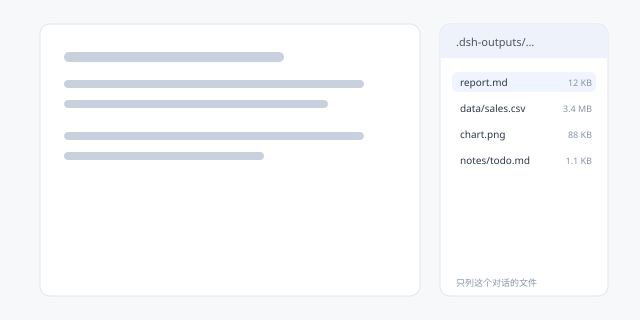

## 它做什么

每个对话获得自己的产物文件夹 `<工作区>/.dsh-outputs/<sessionId>/`，右侧栏新增「本对话产物」页，只列这个文件夹里的文件，点一下就在同一栏里预览。

- **Host 半身**：在 `agent/created` 时创建文件夹，并把该对话的**工作目录**（`workingDirectory` 投影）移进去。只移动工作目录，不碰会话记录的 `header.cwd`。
- **浏览器半身**：注册一个右侧栏 tab 类型 `session-outputs`，用宿主既有的 `workspaceFiles` Remote 读那个文件夹。

## 为什么不改会话的 cwd

会话的 `header.cwd` 不可变，而且同时是沙箱写根、左栏工作区分组依据、右栏内置文件树的根。改它会让会话掉进「未分组」、沙箱缩到产物文件夹、文件树盯错目录。工作目录是每个文件/终端工具真正读取的可变根，移动它即可隔离写入，上面三件事全部不受影响。

## 配置

```yaml
- id: session-outputs
  name: dsh-session-outputs
  config:
    enabled: true            # 总开关
    isolate: true            # false = 只建文件夹，不改工作目录
    mode: managed            # managed = 只管默认工作区；all = 所有对话都隔离
    directory: .dsh-outputs  # 产物文件夹名
```

## 限制

- 只影响新建的对话；已有对话不搬家、历史文件不迁移（面板会明确说明，避免误以为产物丢了）。
- 只隔离顶层对话；子代理与 fork 沿用父对话目录。
- 默认不隔离你手动添加的项目工作区——产物文件夹在工作区内部，工作目录移进去之后项目自身的相对路径就指不到了，所以只有"什么都往里堆"的默认工作区适合隔离。
- 产物文件夹留在工作区内部，所以内置「文件」页与搜索仍能看到它（这是刻意保留的，保证预览、沙箱、`AGENTS.md` 发现照常）。
- 面板最多列出 6 层、400 个文件，超出会明确提示截断；标签页可见时每 5 秒自动刷新。
